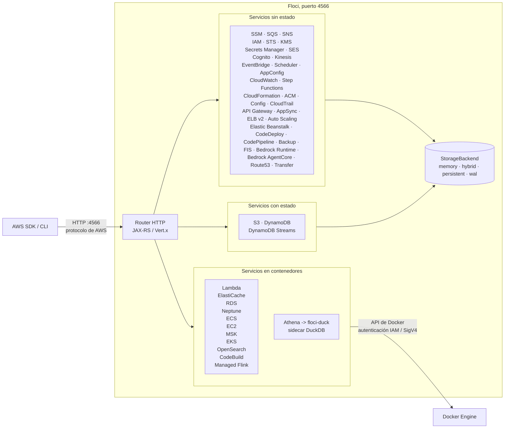

<p align="center">
  
  
</p>

<p align="center">
  <strong>Cualquier nube. En local.</strong><br />
  Ligero, esponjoso y siempre gratis<br />
  Sin cuenta. Sin token de autenticación. Sin funciones bloqueadas. Solo <code>docker compose up</code>.
</p>

<p align="center">
  <a href="https://github.com/floci-io/floci/releases/latest"></a>
  <a href="https://github.com/floci-io/floci/actions/workflows/release.yml"></a>
  <a href="https://hub.docker.com/r/floci/floci"></a>
  <a href="https://hub.docker.com/r/floci/floci"></a>
  <a href="https://opensource.org/licenses/MIT"></a>
  <a href="https://github.com/floci-io/floci/stargazers"></a>
</p>

<p align="center">
  <a href="#inicio-rápido">Inicio rápido</a> ·
  <a href="#características">Características</a> ·
  <a href="#servicios-soportados">Servicios</a> ·
  <a href="#integración-con-sdks">SDKs</a> ·
  <a href="#testcontainers">Testcontainers</a> ·
  <a href="#migrar-desde-localstack">Migración</a> ·
  <a href="https://floci.io/floci/">Documentación</a>
</p>

> **Nota:** esta es una traducción al español del README original en inglés del proyecto [floci-io/floci](https://github.com/floci-io/floci). Los nombres de servicios de AWS, variables de entorno, comandos y bloques de código se dejan tal cual.

---

## ¿Qué es Floci?

Floci es un emulador local de AWS, gratuito y de código abierto, para desarrollo, pruebas e integración continua (CI).

Te da servicios con la misma forma que AWS en tu propia máquina, sin necesidad de una cuenta en la nube, un token de autenticación ni funciones de pago. Apunta tu SDK de AWS, la CLI, Terraform, CDK, OpenTofu o tu batería de tests a `http://localhost:4566` y sigue trabajando como siempre.

¿Ya usas LocalStack? Floci es un reemplazo directo: cambia la imagen y listo. Consulta [Migrar desde LocalStack](#migrar-desde-localstack).

Floci es el miembro dedicado a AWS de la familia de emuladores [Floci](https://github.com/floci-io), cuyo nombre viene de [floccus](https://en.wikipedia.org/wiki/Cirrocumulus_floccus), la formación de nubes que parece palomitas de maíz.

| Emulador | Nube | Puerto |
|---|---|:---:|
| **[floci](https://github.com/floci-io/floci)** | **AWS** | **4566** |
| [floci-az](https://github.com/floci-io/floci-az) | Azure | 4577 |
| [floci-gcp](https://github.com/floci-io/floci-gcp) | GCP | 4588 |
| [floci-oci](https://github.com/floci-io/floci-oci) | OCI | 4599 |

## Inicio rápido

La forma más rápida de ejecutar Floci es con la [CLI](https://github.com/floci-io/floci-cli) oficial:

```bash
floci start
```

¿No tienes Docker? Cada [release](https://github.com/floci-io/floci/releases) incluye también un binario independiente `floci-aws` para Linux, macOS y Windows; consulta [Binario nativo](https://floci.io/floci/getting-started/installation/#native-binary).

Exporta las variables de entorno de AWS:

```bash
eval $(floci env)
```

Usa tus herramientas de AWS de siempre:

```bash
aws s3 mb s3://my-bucket

aws dynamodb create-table \
  --table-name demo-table \
  --attribute-definitions AttributeName=pk,AttributeType=S \
  --key-schema AttributeName=pk,KeyType=HASH \
  --billing-mode PAY_PER_REQUEST

aws dynamodb list-tables
```

### Míralo en acción

Esta breve demo muestra el flujo con la CLI: arrancar Floci, exportar el entorno local de AWS, ejecutar comandos normales de la AWS CLI y detener el emulador.

https://github.com/user-attachments/assets/b55714dc-ef36-40ae-a734-cd2cadc288a8

Todos los servicios de AWS están disponibles en `http://localhost:4566`. Funciona cualquier [región publicada de AWS](https://floci.io/floci/configuration/partitions/), en todas las particiones. Las credenciales pueden ser cualquier valor no vacío, salvo que actives explícitamente comprobaciones de autenticación más estrictas en algún servicio.

<details>
<summary>¿Prefieres Docker Compose?</summary>

Crea un archivo `compose.yaml`:

```yaml
services:
  floci:
    image: floci/floci:latest
    ports:
      - "4566:4566"
```

Arranca Floci:

```bash
docker compose up
```

Luego configura tu entorno de AWS manualmente:

```bash
export AWS_ENDPOINT_URL=http://localhost:4566
export AWS_DEFAULT_REGION=us-east-1
export AWS_ACCESS_KEY_ID=test
export AWS_SECRET_ACCESS_KEY=test
```

> En Windows PowerShell, el equivalente es `$env:AWS_ENDPOINT_URL="http://localhost:4566"` (y así con cada variable).

</details>

<details>
<summary>¿Usas la imagen antigua <code>hectorvent/floci</code>?</summary>

Actualiza el nombre de la imagen:

```yaml
# Antes
image: hectorvent/floci:latest

# Después
image: floci/floci:latest
```

El repositorio antiguo `hectorvent/floci` ya no recibe actualizaciones.

</details>

## Consola web

Floci incluye una consola en el navegador para inspeccionar los recursos de tu emulador local.

**Ábrela en:** `http://localhost:4566/_floci/ui`

No se ejecuta nada al arrancar. La primera petición descarga la imagen de la consola, la inicia como contenedor auxiliar (*sidecar*) en la red Docker de Floci, le pasa la dirección accesible de Floci junto con el entorno estándar de AWS, consulta su endpoint de salud y redirige al navegador cuando la consola confirma que puede llegar a Floci. Docker se encarga de publicar el puerto del sidecar, así que no necesitas añadir ninguna entrada `ports:` propia, y sus logs se envían a CloudWatch Logs bajo `/floci/ui`.

Para iniciar un contenedor se necesita el socket de Docker:

```yaml
services:
  floci:
    image: floci/floci:latest
    ports:
      - "4566:4566"
    volumes:
      - /var/run/docker.sock:/var/run/docker.sock
```

| Variable | Valor por defecto | Descripción |
|---|---|---|
| `FLOCI_SERVICES_UI_ENABLED` | `true` | Activa el sidecar de la consola |
| `FLOCI_SERVICES_UI_IMAGE` | `floci/floci-ui:0.7.0` | Imagen de la consola a ejecutar |
| `FLOCI_SERVICES_UI_CONTAINER_NAME` | `floci-ui` | Nombre del contenedor sidecar |
| `FLOCI_SERVICES_UI_PORT` | `4500` | Puerto del host en el que se publica la consola |
| `FLOCI_SERVICES_UI_BIND_ADDRESS` | _(ninguno)_ | Interfaz del host en la que se publica ese puerto. Si no se define, se publica en todas; usa `127.0.0.1` cuando el puerto de Floci solo escucha en loopback |
| `FLOCI_SERVICES_UI_KEEP_RUNNING_ON_SHUTDOWN` | `false` | Deja el sidecar en marcha cuando Floci se detiene |

### Usar otra consola

La consola no tiene por qué ser la que trae Floci. Cualquier consola que implemente el [contrato de consola de Floci](https://floci.io/floci/ui/console-contract/) funciona indicando solo el nombre de la imagen: debe escuchar en el puerto de `PORT`, responder a `GET /api/health` y hablar con Floci en `AWS_ENDPOINT_URL`.

```yaml
environment:
  FLOCI_SERVICES_UI_IMAGE: acme/my-console:1.0
```

Una consola que se aparte de los valores por defecto del contrato lo declara en sus propias etiquetas de imagen `io.floci.console.*`, para que quien la use no tenga que hacerlo. [StackPort](https://github.com/DaviReisVieira/stackport), por ejemplo, escucha en el 8080 en lugar del 4500; con una imagen anterior a esas etiquetas, indícalo a mano:

```yaml
environment:
  FLOCI_SERVICES_UI_IMAGE: davireis/stackport:latest
  FLOCI_SERVICES_UI_CONTAINER_NAME: floci-stackport
  FLOCI_SERVICES_UI_PORT: "8080"
  FLOCI_SERVICES_UI_INTERNAL_PORT: "8080"
```

[Floci Dash](https://github.com/ofsazib/floci-dash) es otra opción. Respeta `PORT`, así que solo hay que indicar las dos cosas en las que difiere:

```yaml
environment:
  FLOCI_SERVICES_UI_IMAGE: ghcr.io/ofsazib/floci-dash:latest
  FLOCI_SERVICES_UI_CONTAINER_NAME: floci-dash
  FLOCI_SERVICES_UI_ENDPOINT_ENV: FLOCI_URL
  FLOCI_SERVICES_UI_STATUS_PATH: /api/healthz
```

El endpoint en sí nunca se configura a mano: Floci averigua su propia dirección accesible al arrancar y la inyecta como `AWS_ENDPOINT_URL`.

Referencia completa: [Consola web](https://floci.io/floci/ui/) y [Contrato de consola v1](https://floci.io/floci/ui/console-contract/).

## Características

<details open>
<summary><strong>AWS en local sin cuenta en la nube</strong></summary>

Ejecuta servicios compatibles con AWS en local, sin cuenta de AWS, sin token de autenticación y sin funciones de pago.

</details>

<details>
<summary><strong>Docker real donde importa la fidelidad</strong></summary>

Lambda, RDS, Neptune, ElastiCache, MSK, ECS, EC2, EKS, OpenSearch, CodeBuild y Managed Service for Apache Flink se ejecutan sobre contenedores Docker reales en lugar de simulaciones superficiales (*mocks*).

</details>

<details>
<summary><strong>Compatibilidad directa con AWS</strong></summary>

Apunta los clientes estándar de AWS a `http://localhost:4566`. Tus credenciales, regiones, SDKs, comandos de la CLI y flujos de infraestructura como código (IaC) siguen funcionando igual.

Terraform puede crear recursos con forma de AWS en local a través de Floci usando el proveedor estándar de AWS de HashiCorp. Consulta la [guía de Terraform con Floci](docs/getting-started/terraform.md) para la configuración del proveedor, ejemplos de recursos y el estado opcional en S3 emulado.

</details>

<details>
<summary><strong>Lo bastante rápido para CI</strong></summary>

La imagen nativa arranca en milisegundos y consume poca memoria en reposo, lo que la hace práctica para desarrollo local y pipelines de pruebas.

</details>

<details>
<summary><strong>Persistencia configurable</strong></summary>

Elige entre almacenamiento en memoria, persistente, híbrido o con registro de escritura anticipada (WAL), según la durabilidad que necesites.

</details>

## ¿Por qué Floci?

La edición comunitaria de LocalStack [dejó de mantenerse en marzo de 2026](https://blog.localstack.cloud/the-road-ahead-for-localstack/): ahora exige tokens de autenticación y congeló las actualizaciones de seguridad. Floci es la alternativa sin ataduras.

| Capacidad | Floci | LocalStack Community |
|---|:---:|:---:|
| Requiere token de autenticación | No | Sí |
| Actualizaciones de seguridad | Sí | Congeladas |
| Tiempo de arranque | ~24 ms | ~3,3 s |
| Memoria en reposo | ~13 MiB | ~143 MiB |
| Tamaño de la imagen Docker | ~90 MB | ~1,0 GB |
| Licencia | MIT | Restringida |
| API Gateway v2 / HTTP API | Sí | No |
| Cognito | Sí | No |
| RDS, ElastiCache, MSK | Docker real | No |
| Neptune (BD de grafos + WebSocket Gremlin) | Docker real | No |
| DocumentDB (compatible con MongoDB) | Docker real | No |
| ECS, EC2, EKS | Docker real | No |
| CodeBuild | Ejecución real en Docker | No |
| Binario nativo | ~40 MB | No |

**Amplia cobertura de AWS. Gratis para siempre.** Consulta el [resumen de servicios](https://floci.io/floci/services/) para ver la lista completa de servicios emulados.

## Arquitectura general



## Servicios soportados

Floci emula en local servicios de aplicación, de datos, de eventos, de identidad, de infraestructura, de facturación y cargas de trabajo basadas en contenedores.

| Categoría | Servicios |
|---|---|
| Servicios básicos de aplicación | S3, SQS, SNS, DynamoDB, Lambda, Lambda MicroVMs, Lambda Web Functions, IAM, STS, KMS, Payment Cryptography, Secrets Manager, SSM |
| Eventos y flujos de trabajo | EventBridge, EventBridge V2, EventBridge Pipes, EventBridge Scheduler, Step Functions, SWF, CloudWatch Logs, CloudWatch Metrics, CloudWatch OAM, CloudWatch RUM, Managed Prometheus (AMP) |
| API e identidad | API Gateway REST, API Gateway v2, AppSync, Cognito, Cognito Identity, ACM, Route53, Route 53 Resolver, Cloud Map, Global Accelerator |
| Contenedores y cómputo | ECS, EC2, Lightsail, EKS, MWAA, ECR, EFS, CodeBuild, CodeDeploy, CodePipeline, CodeGuru Reviewer, CodeArtifact, AWS Batch, Auto Scaling, Application Auto Scaling, Elastic Beanstalk, ELB v2, ELB Classic |
| Datos, analítica e IA | Athena, Glue, Lake Formation, EMR, EMR Serverless, Redshift, Redshift Data API, Redshift Serverless, Firehose, Managed Service for Apache Flink, OpenSearch, S3 Tables, S3 Vectors, Textract, Transcribe, Comprehend, Rekognition, Translate, Bedrock, Bedrock Runtime, Bedrock AgentCore, Bedrock AgentCore Control, SageMaker |
| Bases de datos y caché | Aurora DSQL, RDS, RDS Data API, Neptune, DocumentDB, DMS, MemoryDB, ElastiCache, Timestream for InfluxDB |
| Mensajería y transferencia | SES, Kinesis, MSK, Amazon MQ, Transfer Family, DataSync, IoT Core, Amazon Connect, Amazon AppIntegrations |
| Seguridad y gobernanza | AWS Network Firewall, AWS RAM, Service Quotas, WAF v2, GuardDuty, Amazon Inspector, CloudTrail, CloudFront, Resource Groups Tagging API, Resource Explorer 2, CloudHSM v2, Organizations, AWS Account Management, IAM Access Analyzer, IAM Identity Center (SSO Admin, OIDC, Access Portal, SCIM), Identity Store, Amazon Macie, Amazon Detective, Security Hub, Amazon Verified Permissions, Control Catalog, Control Tower, Service Catalog, AWS Marketplace |
| Costes y facturación | AWS Budgets, Pricing, Cost Explorer, Cost and Usage Reports, BCM Pricing Calculator, BCM Data Exports |
| Resiliencia, copias de seguridad y configuración | AWS FIS, AWS Backup, Amazon Data Lifecycle Manager, AWS Config, AppConfig, AppConfigData, CloudFormation, Cloud Control API |

Para la compatibilidad a nivel de operación, consulta el [resumen de servicios](https://floci.io/floci/services/).

<details>
<summary>Notas detalladas por servicio</summary>

"En proceso" significa que el servicio se emula dentro del propio proceso de Floci; "Docker real" significa que se levanta un contenedor real.

| Servicio | Cómo funciona | Funciones destacadas |
|---|---|---|
| SSM | En proceso + contenedores EC2 | Parameter Store (historial de versiones, etiquetas, SecureString, tags); Run Command (SendCommand, GetCommandInvocation, ejecución directa en contenedores EC2, sondeo del agente) |
| SQS | En proceso | Colas estándar y FIFO, DLQ, timeout de visibilidad, operaciones por lotes, tags |
| SNS | En proceso | Topics, suscripciones, entrega a SQS, Lambda y HTTP, tags |
| S3 | En proceso | Versionado, subida multiparte, URLs prefirmadas, Object Lock, anotaciones de objetos, notificaciones de eventos |
| S3 Vectors | En proceso | Buckets de vectores, índices, put / get / list / delete de vectores, consultas por similitud coseno |
| DynamoDB | En proceso | GSI, LSI, Query, Scan, TTL, transacciones, operaciones por lotes; Streams con iteradores de shard y mapeo de eventos a Lambda |
| Lambda | Docker real | Entorno de ejecución, modelo de ejecución, pool de contenedores calientes, alias, Function URLs |
| API Gateway REST | En proceso | Recursos, métodos, stages, proxy a Lambda, integraciones MOCK y AWS |
| API Gateway v2 | En proceso | HTTP APIs, rutas, integraciones, autorizadores JWT, stages |
| AppSync | En proceso | API de gestión de APIs GraphQL, registro de esquemas, escalares de AWS, nombres de dominio, namespaces de canales |
| IAM | En proceso | Usuarios, roles, grupos, políticas, perfiles de instancia, claves de acceso; STS AssumeRole, WebIdentity, SAML, GetFederationToken, GetSessionToken |
| Cognito | En proceso | User pools, clientes de aplicación, flujos de autenticación, endpoints JWKS y OpenID well-known |
| KMS | En proceso | Cifrar, descifrar, firmar, verificar, claves de datos, alias |
| Payment Cryptography | En proceso | Claves con material AES-256 real y valores de comprobación, alias, tags |
| Kinesis | En proceso | Streams, shards, enhanced fan-out, división y fusión |
| Secrets Manager | En proceso | Versionado, políticas de recurso, tags |
| Step Functions | En proceso | Ejecución de ASL, task tokens, historial de ejecuciones |
| SWF | En proceso | Tareas de decisión y actividad, temporizadores, workflows hijos, timeouts, invocación real de Lambda |
| CloudFormation | En proceso | Stacks, change sets, aprovisionamiento de recursos, StackSets (instancias entre cuentas) |
| EventBridge | En proceso | Buses personalizados, reglas, destinos SQS, SNS y Lambda |
| EventBridge V2 | En proceso | Buses de eventos y suscriptores filtrados que entregan a SQS |
| EventBridge Pipes | En proceso | Integración por sondeo que conecta fuentes SQS, Kinesis, DynamoDB y MSK con destinos, con filtrado opcional |
| EventBridge Scheduler | En proceso | Grupos de programación, programaciones, ventanas de tiempo flexibles, políticas de reintento, DLQs |
| CloudWatch Logs | En proceso | Grupos de logs, streams, ingesta, filtrado |
| CloudWatch Metrics | En proceso | Métricas personalizadas, estadísticas, alarmas |
| CloudWatch OAM | En proceso | API completa de 15 operaciones: sinks, políticas, enlaces entre cuentas y tags |
| ElastiCache | Docker real | Protocolo Redis / Valkey, autenticación IAM, validación SigV4 |
| MemoryDB | Docker real | Protocolo Redis / Valkey con contenedores reales; plano de control JSON 1.1; reutiliza el proxy RESP de ElastiCache |
| Aurora DSQL | Docker real, modo mock disponible | PostgreSQL 16 por clúster detrás de un endpoint TLS con autenticación por token IAM, mapeos de roles `AWS IAM GRANT`; todavía sin los límites ni los índices asíncronos de DSQL |
| RDS | Docker real | PostgreSQL, MySQL, MariaDB, autenticación IAM, motores compatibles con JDBC |
| Timestream for InfluxDB | Docker real, modo mock disponible | Instancias InfluxDB 2.x y clústeres de réplicas de lectura con `influxdb:2.7`; secreto de autenticación inicial en Secrets Manager; copias de seguridad y restauración con la CLI de influx |
| RDS Data API | REST JSON sobre contenedores RDS reales | Ejecución de SQL y transacciones para recursos RDS locales MySQL / MariaDB |
| Neptune | Docker real | BD de grafos con TinkerPop Gremlin Server (por defecto) o Neo4j para openCypher/Bolt (`NEPTUNE_DB_TYPE`); plano de control al estilo RDS; proxy SigV4 en el puerto 8182 |
| DocumentDB | Docker real, modo mock disponible | Clúster compatible con MongoDB usando contenedores MongoDB reales; plano de control al estilo RDS; protocolo MongoDB en el puerto 27017 |
| MSK | Docker real | Broker compatible con Kafka mediante Redpanda |
| Amazon MQ | Docker real | Broker RabbitMQ con rabbitmq:3-management; AMQP + consola de gestión |
| Athena | En proceso con sidecar DuckDB | Ejecución real de SQL sobre S3 y vistas respaldadas por Glue |
| Glue | En proceso | Data Catalog, Schema Registry, tablas consumidas por Athena |
| EMR | En proceso | Ciclo de vida de clústeres (job flows), grupos y flotas de instancias (incluido redimensionado), acciones de arranque, steps, configuraciones de seguridad, políticas de escalado y terminación, bloqueo de acceso público, tags |
| Data Firehose | En proceso | Entrega en streaming, volcado con buffer a S3 con compresión GZIP/ZIP/Snappy |
| Managed Service for Apache Flink | Docker real | Plano de control de Kinesis Analytics V2; StartApplication levanta un clúster Flink real (JobManager + TaskManager, imagen según RuntimeEnvironment), descarga el JAR de la aplicación desde el S3 local y envía el job |
| ECS | Docker real | Clústeres, definiciones de tareas, tareas, servicios, proveedores de capacidad, task sets |
| EC2 | Docker real | RunInstances lanza contenedores, inyección de claves SSH, UserData, IMDS, recursos de VPC |
| Lightsail | En proceso | Instancias, discos, IPs estáticas, pares de claves, puertos, tags, regiones, blueprints, bundles, operaciones |
| ACM | En proceso | Ciclo de vida de emisión y validación de certificados |
| ECR | En proceso con registro real | Repositorios, docker push / pull, funciones Lambda basadas en imágenes |
| Resource Groups Tagging API | En proceso | GetResources, etiquetar y desetiquetar recursos, descubrimiento de claves y valores de tags entre servicios |
| SES | En proceso | APIs v1 y v2: envío de correo, correo raw, verificación de identidades, DKIM, plantillas, configuration sets, envío a nivel de cuenta |
| OpenSearch | Docker real | CRUD de dominios, tags, versiones, tipos de instancia, stubs de actualización |
| AppConfig | En proceso | Aplicaciones, entornos, perfiles, versiones alojadas, despliegues |
| AppConfigData | En proceso | Sesiones de configuración y obtención dinámica de configuración |
| Bedrock | En proceso | Ciclo de vida, versiones y tags de guardrails en el plano de control |
| Bedrock Runtime | Stub en proceso | Respuestas ficticias de Converse e InvokeModel para desarrollo local |
| Bedrock AgentCore | Stub en proceso | Plano de control con estado (runtimes de agentes, gateways, memoria, identidad de cargas de trabajo); respuestas predefinidas de InvokeAgentRuntime |
| EKS | Docker real, modo mock disponible | Clústeres k3s con API server de Kubernetes funcionando |
| MWAA | Docker real, modo mock disponible | Apache Airflow real (LocalExecutor) + BD de metadatos Postgres por entorno; proxy web/CLI; sincronización de DAGs desde S3 |
| ELB v2 | En proceso | ALB, NLB, target groups, listeners, reglas de enrutamiento, destinos Lambda, tags |
| CodeBuild | En proceso con Docker real | Ejecución real de buildspec, logs en CloudWatch, artefactos en S3 |
| CodeDeploy | En proceso con desvío de tráfico en Lambda | Grupos de despliegue, configuraciones, hooks de ciclo de vida, rollback automático |
| CodePipeline | Orquestación en proceso | Pipelines, ejecuciones, artefactos en S3, aprobaciones, proveedores locales, workers personalizados |
| AWS Network Firewall | En proceso | DescribeFirewall con endpoints emulados estables para herramientas de infraestructura |
| Service Quotas | En proceso | Catálogo de cuotas generado con valores estáticos generosos; códigos de cuota reales para CodeBuild y concurrencia de Lambda |
| AWS RAM | En proceso | Activación de EnableSharingWithAwsOrganization |
| AWS Batch | En proceso | Entornos de cómputo, colas de jobs, definiciones de jobs, envío y ciclo de vida de jobs |
| Auto Scaling | En proceso con reconciliador | Launch configs, ASGs, reconciliación de capacidad deseada, hooks de ciclo de vida |
| Application Auto Scaling | En proceso | Scalable targets, políticas de target-tracking y por pasos, creación de alarmas en CloudWatch, tags (las políticas se guardan pero no actúan) |
| Elastic Beanstalk | En proceso | Aplicaciones, versiones de aplicación, entornos, plantillas de configuración, metadatos de plataformas y solution stacks |
| AWS Backup | En proceso | Vaults, planes de backup, selecciones, ciclo de vida simulado de jobs, puntos de recuperación |
| Amazon Data Lifecycle Manager | En proceso | Gestión de políticas de ciclo de vida y tags; las programaciones se guardan pero no crean snapshots ni AMIs |
| AWS FIS | En proceso | Las 26 APIs de gestión de plantillas, experimentos, cuentas destino, descubrimiento de acciones y destinos, safety lever, tags y paginación; la ejecución de experimentos es una simulación segura del plano de control y no inyecta fallos en otros servicios |
| AWS Config | En proceso | Reglas de Config, cumplimiento basado en evaluaciones (PutEvaluations, detalles y resúmenes de cumplimiento), grabadores de configuración, canales de entrega, configuración de retención, conformance packs, tags |
| Organizations | En proceso | Organizaciones, raíces, OUs anidadas, cuentas miembro, todos los tipos de políticas con `FullAWSAccess` y herencia de política efectiva, acceso de servicios de confianza, administradores delegados, política de recurso y el flujo completo de invitaciones/handshake; las cuentas creadas son cuentas Floci utilizables y las cuentas miembro pueden leer la organización a la que pertenecen |
| CloudTrail | En proceso | Trails, selectores de eventos (eventos de datos de S3 con coincidencia por bucket/prefijo), `StartLogging`/`StopLogging`, emisión programada de archivos de log comprimidos con gzip al bucket destino con rutas al estilo AWS; las denegaciones de IAM generan registros `AccessDenied` |
| CloudFront | En proceso | Distribuciones, orígenes, comportamientos de caché, invalidaciones, tags |
| WAF v2 | En proceso | Web ACLs, IP sets, conjuntos de patrones regex, grupos de reglas, configuraciones de logging, asociaciones de recursos, tags (ámbitos REGIONAL y CLOUDFRONT) |
| AWS Resource Groups | En proceso | Cinco operaciones de pools de capacidad: grupos guardados, pertenencia verificada de reservas EC2, paginación por ámbito y borrado de grupos; sin consultas dinámicas ni asignación de capacidad |
| Resource Explorer 2 | En proceso | Las 32 APIs de gestión: ciclo de vida de índices y vistas, tareas de configuración multirregión, la gramática completa de consultas de búsqueda y tags; 30 servicios exponen sus recursos para búsqueda, obtenidos en vivo en lugar de desde un índice |
| Route53 | En proceso | Zonas alojadas, registros SOA y NS, conjuntos de registros, seguimiento de cambios, tags |
| Cloud Map | En proceso | Namespaces HTTP y DNS, servicios, registro de instancias, consultas de descubrimiento, operaciones, tags |
| Transfer Family | En proceso | Ciclo de vida de servidores, gestión de usuarios, importación de claves SSH, tags |
| Textract | Stub en proceso | Stubs compatibles con la API, datos de bloques ficticios, simulación de jobs asíncronos |
| Transcribe | Stub en proceso | Jobs de transcripción y vocabularios personalizados; los jobs terminan al instante, sin procesar audio real |
| Pricing | En proceso con snapshot estático | Descubrimiento de productos, atributos, archivos de listas de precios, paginación |
| Cost Explorer | En proceso | Costes sintetizados a partir del estado de los recursos en Floci y snapshots de precios |
| Cost and Usage Reports | En proceso con sidecar floci-duck | Columnas CUR 2.0 y FOCUS 1.2, almacenamiento por cuenta, emisión en Parquet |
| BCM Pricing Calculator | En proceso | Ciclo de vida de estimaciones de carga de trabajo: creación, precios de uso, lectura y borrado |
| BCM Data Exports | En proceso | Ciclo de vida de exportaciones, ejecuciones, actualización y borrado |

</details>

## Integración con Docker real

Floci usa contenedores Docker reales cuando la emulación dentro del proceso reduciría la fidelidad. Esto se aplica a bases de datos con estado, protocolos con muchas conexiones, entornos de ejecución y sistemas de build.

| Servicio | Imagen por defecto | Qué es real |
|---|---|---|
| Lambda | `public.ecr.aws/lambda/<runtime>` | Entorno de ejecución de AWS, modelo de ejecución, pool de contenedores calientes |
| ElastiCache | `valkey/valkey:8` | Protocolo Redis / Valkey, autenticación IAM basada en ACL, validación SigV4 |
| RDS PostgreSQL | `postgres:16-alpine` | Motor PostgreSQL, autenticación IAM, acceso compatible con JDBC |
| RDS MySQL / Aurora | `mysql:8.0` | Motor MySQL, autenticación IAM, acceso compatible con JDBC |
| RDS MariaDB | `mariadb:11` | Motor MariaDB, autenticación IAM, acceso compatible con JDBC |
| Neptune | `tinkerpop/gremlin-server:3.7.3` | TinkerPop Gremlin Server; WebSocket Gremlin en el puerto 8182; proxy de autenticación SigV4 |
| Neptune (openCypher) | `neo4j:5-community` | Backend Neo4j cuando `FLOCI_SERVICES_NEPTUNE_DB_TYPE=neo4j`; openCypher sobre Bolt |
| DocumentDB | `mongo:7.0` | Motor MongoDB; protocolo MongoDB en el puerto 27017 |
| MSK | `redpandadata/redpanda:latest` | Broker compatible con Kafka mediante Redpanda |
| Amazon MQ | `rabbitmq:3-management` | Broker RabbitMQ; AMQP en el puerto 5672, consola de gestión en el 15672 |
| Managed Service for Apache Flink | `apache/flink:<version>` | JobManager de Apache Flink; imagen elegida según RuntimeEnvironment (FLINK-1_15 … FLINK-1_20, FLINK-2_0 … FLINK-2_3) |
| EC2 | Imágenes Linux mapeadas a AMIs | Contenedores Linux, inyección de claves SSH, UserData, IMDS, credenciales IAM |
| ECS | Imagen de tarea indicada por el usuario | Ciclo de vida de contenedores, arranque, parada, health checks |
| EKS | `rancher/k3s:latest` | API server de Kubernetes mediante k3s |
| MWAA | `apache/airflow:<version>-python3.12` + `postgres:16-alpine` | Apache Airflow real (LocalExecutor: scheduler + webserver) con su propia BD de metadatos Postgres; webserver/CLI accesibles mediante el proxy de Floci |
| CodeBuild | Imagen de entorno indicada por el usuario | Ejecución de buildspec, streaming de logs, subida de artefactos a S3 |
| OpenSearch | `opensearchproject/opensearch:2` | Motor OpenSearch completo con API REST |
| ECR | `registry:2` | Registro compatible con OCI para docker push y docker pull |
| Verified Permissions | `floci/floci-sidecar-cedar:1.1.0` | Análisis de políticas Cedar 4, validación de esquemas y decisiones de autorización, mediante un [sidecar de Floci](https://github.com/floci-io/floci-sidecars) |
| AppSync | `floci/floci-sidecar-graphql:0.2.0` | Validación de esquemas, planificación y ejecución de consultas con graphql-java, mediante un [sidecar de Floci](https://github.com/floci-io/floci-sidecars) |

Los servicios basados en Docker necesitan el socket de Docker:

```bash
docker run -d --name floci \
  -p 4566:4566 \
  -v /var/run/docker.sock:/var/run/docker.sock \
  -u root \
  floci/floci:latest
```

### Cambiar las imágenes por defecto

| Variable | Valor por defecto |
|---|---|
| `FLOCI_SERVICES_ELASTICACHE_DEFAULT_IMAGE` | `valkey/valkey:8` |
| `FLOCI_SERVICES_RDS_DEFAULT_POSTGRES_IMAGE` | `postgres:16-alpine` |
| `FLOCI_SERVICES_RDS_DEFAULT_MYSQL_IMAGE` | `mysql:8.0` |
| `FLOCI_SERVICES_RDS_DEFAULT_MARIADB_IMAGE` | `mariadb:11` |
| `FLOCI_SERVICES_MSK_DEFAULT_IMAGE` | `redpandadata/redpanda:latest` |
| `FLOCI_SERVICES_OPENSEARCH_DEFAULT_IMAGE` | *(sin definir: las imágenes se eligen según el `EngineVersion` solicitado)* |
| `FLOCI_SERVICES_KINESIS_ANALYTICS_DEFAULT_IMAGE` | _(sin definir; se elige según RuntimeEnvironment)_ |
| `FLOCI_SERVICES_NEPTUNE_DEFAULT_IMAGE` | `tinkerpop/gremlin-server:3.7.3` |
| `FLOCI_SERVICES_NEPTUNE_DEFAULT_NEO4J_IMAGE` | `neo4j:5-community` |
| `FLOCI_SERVICES_DOCDB_DEFAULT_IMAGE` | `mongo:7.0` |
| `FLOCI_SERVICES_EKS_DEFAULT_IMAGE` | `rancher/k3s:latest` |
| `FLOCI_SERVICES_MWAA_DEFAULT_POSTGRES_IMAGE` | `postgres:16-alpine` |
| `FLOCI_SERVICES_ECR_REGISTRY_IMAGE` | `registry:2` |
| `FLOCI_SERVICES_LAMBDA_ECR_BASE_URI` | `public.ecr.aws` |

## Persistencia y modos de almacenamiento

Floci puede priorizar velocidad o durabilidad según tu flujo de trabajo. Configura el modo por defecto con `FLOCI_STORAGE_MODE`, o cámbialo por servicio.

| Modo | Comportamiento | Ideal para | Durabilidad |
|---|---|---|:---:|
| `memory` | Todo en RAM. Los datos se pierden al detener el contenedor. | CI y pruebas efímeras | Ninguna |
| `persistent` | Se carga al arrancar y se escribe en disco inmediatamente en cada operación de escritura. | Conservar el estado local de forma sencilla con persistencia inmediata | Media |
| `hybrid` | Rendimiento de memoria con volcado asíncrono periódico cada 5 segundos. | Desarrollo local | Buena |
| `wal` | Registro de escritura anticipada (*write-ahead log*). Cada cambio se registra antes de responder. | Máxima durabilidad | La más alta |

Usa `memory` para ejecuciones de tests rápidas. Usa `hybrid` si quieres conservar el estado entre reinicios del contenedor sin mucha sobrecarga.

Para más detalle, consulta la [documentación de configuración de almacenamiento](https://floci.io/floci/configuration/storage/).

## Aislamiento entre cuentas

Floci aísla los recursos por cuenta sin configuración adicional. Si `AWS_ACCESS_KEY_ID` tiene exactamente 12 dígitos, Floci lo usa como ID de cuenta. Los recursos creados por una cuenta son invisibles para otra.

```bash
AWS_ACCESS_KEY_ID=111111111111 aws sqs create-queue --queue-name orders
AWS_ACCESS_KEY_ID=222222222222 aws sqs create-queue --queue-name orders
```

Con cualquier otro formato de clave, como `test` o `AKIA...`, Floci usa `FLOCI_DEFAULT_ACCOUNT_ID`, que por defecto es `000000000000`.

Las credenciales temporales de STS también se enrutan: las obtenidas con `AssumeRole` se resuelven a la cuenta del rol asumido, así que el patrón de "asumir rol en otra cuenta y luego aprovisionar" funciona en local. El orden de resolución es: AKID de 12 dígitos → búsqueda de sesión temporal → `FLOCI_DEFAULT_ACCOUNT_ID`.

Consulta la [documentación de aislamiento entre cuentas](https://floci.io/floci/configuration/multi-account/).

## Integración con SDKs

Apunta tu SDK de AWS de siempre a `http://localhost:4566`.

<details>
<summary><strong>Java, AWS SDK v2</strong></summary>

```java
var client = DynamoDbClient.builder()
    .endpointOverride(URI.create("http://localhost:4566"))
    .region(Region.US_EAST_1)
    .credentialsProvider(StaticCredentialsProvider.create(
        AwsBasicCredentials.create("test", "test")))
    .build();

client.createTable(b -> b
    .tableName("demo-table")
    .billingMode(BillingMode.PAY_PER_REQUEST)
    .attributeDefinitions(
        AttributeDefinition.builder().attributeName("pk").attributeType(ScalarAttributeType.S).build())
    .keySchema(
        KeySchemaElement.builder().attributeName("pk").keyType(KeyType.HASH).build()));

System.out.println(client.listTables().tableNames());
```

</details>

<details>
<summary><strong>Python, boto3</strong></summary>

```python
import boto3

client = boto3.client(
    "ssm",
    endpoint_url="http://localhost:4566",
    region_name="us-east-1",
    aws_access_key_id="test",
    aws_secret_access_key="test",
)

client.put_parameter(
    Name="/demo/app/message",
    Value="hello from floci",
    Type="String",
    Overwrite=True,
)

response = client.get_parameter(Name="/demo/app/message")
print(response["Parameter"]["Value"])
```

</details>

<details>
<summary><strong>Node.js, AWS SDK v3</strong></summary>

```javascript
import { SQSClient, SendMessageCommand } from "@aws-sdk/client-sqs";

const client = new SQSClient({
  endpoint: "http://localhost:4566",
  region: "us-east-1",
  credentials: { accessKeyId: "test", secretAccessKey: "test" },
});

await client.send(
  new SendMessageCommand({
    QueueUrl: "http://localhost:4566/000000000000/demo-queue",
    MessageBody: "hello from floci",
  }),
);
```

</details>

<details>
<summary><strong>Go, AWS SDK v2</strong></summary>

```go
package main

import (
    "context"
    "fmt"
    "log"

    "github.com/aws/aws-sdk-go-v2/config"
    "github.com/aws/aws-sdk-go-v2/credentials"
    "github.com/aws/aws-sdk-go-v2/service/s3"
)

func main() {
    cfg, err := config.LoadDefaultConfig(context.TODO(),
        config.WithRegion("us-east-1"),
        config.WithCredentialsProvider(
            credentials.NewStaticCredentialsProvider("test", "test", ""),
        ),
        config.WithBaseEndpoint("http://localhost:4566"),
    )
    if err != nil {
        log.Fatal(err)
    }

    client := s3.NewFromConfig(cfg, func(o *s3.Options) {
        o.UsePathStyle = true
    })

    out, err := client.ListBuckets(context.TODO(), nil)
    if err != nil {
        log.Fatal(err)
    }

    fmt.Println(out.Buckets)
}
```

</details>

<details>
<summary><strong>Rust, AWS SDK</strong></summary>

```rust
use aws_sdk_secretsmanager::config::{Credentials, Region};
use aws_sdk_secretsmanager::Client;

#[tokio::main]
async fn main() -> Result<(), Box<dyn std::error::Error>> {
    let config = aws_config::defaults(aws_config::BehaviorVersion::latest())
        .region(Region::new("us-east-1"))
        .credentials_provider(Credentials::new("test", "test", None, None, "floci"))
        .endpoint_url("http://localhost:4566")
        .load()
        .await;

    let client = Client::new(&config);

    client
        .create_secret()
        .name("demo/secret")
        .secret_string("hello from floci")
        .send()
        .await?;

    Ok(())
}
```

</details>

<details>
<summary><strong>Bash, AWS CLI</strong></summary>

```bash
export AWS_ACCESS_KEY_ID=test
export AWS_SECRET_ACCESS_KEY=test
export AWS_DEFAULT_REGION=us-east-1

aws --endpoint-url http://localhost:4566 s3 mb s3://my-bucket
aws --endpoint-url http://localhost:4566 s3 ls
```

</details>

## Testcontainers

Floci tiene módulos de Testcontainers para levantar instancias aisladas de Floci directamente desde los tests. Así evitas estado compartido, configurar un servicio a mano y conflictos de puertos.

Para Testcontainers 1.x, usa las versiones indicadas en la tabla.

| Lenguaje | Paquete | Última versión | Registro | Código fuente |
|---|---|---|---|---|
| Java | `io.floci:testcontainers-floci` | `1.14.0` | [Maven Central](https://mvnrepository.com/artifact/io.floci/testcontainers-floci) | [GitHub](https://github.com/floci-io/testcontainers-floci) |
| Node.js | `@floci/testcontainers` | `0.1.0` | [npm](https://www.npmjs.com/package/@floci/testcontainers) | [GitHub](https://github.com/floci-io/testcontainers-floci-node) |
| Python | `testcontainers-floci` | `0.1.1` | [PyPI](https://pypi.org/project/testcontainers-floci/) | [GitHub](https://github.com/floci-io/testcontainers-floci-python) |
| .NET | `Testcontainers.Floci` | ver releases | [GitHub Packages](https://github.com/orgs/floci-io/packages?repo_name=testcontainers-floci-dotnet) | [GitHub](https://github.com/floci-io/testcontainers-floci-dotnet) |
| Go | En desarrollo | En desarrollo | N/D | [GitHub](https://github.com/floci-io/testcontainers-floci-go) |

<details>
<summary><strong>Java</strong></summary>

```xml
<dependency>
    <groupId>io.floci</groupId>
    <artifactId>testcontainers-floci</artifactId>
    <version>1.14.0</version>
    <scope>test</scope>
</dependency>
```

```java
@Testcontainers
class S3IntegrationTest {

    @Container
    static FlociContainer floci = new FlociContainer();

    @Test
    void shouldCreateBucket() {
        S3Client s3 = S3Client.builder()
                .endpointOverride(URI.create(floci.getEndpoint()))
                .region(Region.of(floci.getRegion()))
                .credentialsProvider(StaticCredentialsProvider.create(
                        AwsBasicCredentials.create(floci.getAccessKey(), floci.getSecretKey())))
                .forcePathStyle(true)
                .build();

        s3.createBucket(b -> b.bucket("my-bucket"));
    }
}
```

Para Testcontainers 2.x / Spring Boot 4.x, usa la versión `2.15.0`.

</details>

<details>
<summary><strong>Node.js / TypeScript</strong></summary>

```sh
npm install --save-dev @floci/testcontainers
```

```ts
import { FlociContainer } from "@floci/testcontainers";
import { S3Client, CreateBucketCommand } from "@aws-sdk/client-s3";

describe("S3", () => {
  let floci: FlociContainer;

  beforeAll(async () => {
    floci = await new FlociContainer().start();
  });

  afterAll(async () => {
    await floci.stop();
  });

  it("creates a bucket", async () => {
    const s3 = new S3Client({
      endpoint: floci.getEndpoint(),
      region: floci.getRegion(),
      credentials: {
        accessKeyId: floci.getAccessKey(),
        secretAccessKey: floci.getSecretKey(),
      },
      forcePathStyle: true,
    });

    await s3.send(new CreateBucketCommand({ Bucket: "my-bucket" }));
  });
});
```

</details>

<details>
<summary><strong>Python</strong></summary>

```sh
pip install testcontainers-floci
```

```python
import boto3
from floci import FlociContainer


def test_s3_create_bucket():
    with FlociContainer() as floci:
        s3 = boto3.client(
            "s3",
            endpoint_url=floci.get_endpoint(),
            region_name=floci.get_region(),
            aws_access_key_id=floci.get_access_key(),
            aws_secret_access_key=floci.get_secret_key(),
        )
        s3.create_bucket(Bucket="my-bucket")
```

</details>

## Pruebas de compatibilidad

El directorio [`compatibility-tests`](./compatibility-tests/) valida Floci con distintos SDKs y herramientas.

| Módulo | Lenguaje / herramienta | SDK / cliente | Tests |
|---|---|---|---:|
| `sdk-test-java` | Java 17 | AWS SDK for Java v2 | 1.326 |
| `sdk-test-node` | Node.js | AWS SDK for JavaScript v3 | 449 |
| `sdk-test-python` | Python 3 | boto3 | 311 |
| `sdk-test-go` | Go | AWS SDK for Go v2 + RDS Data API SDK v1 | 157 |
| `sdk-test-awscli` | Bash | AWS CLI v2 | 205 |
| `compat-terraform` | Terraform | v1.10+ | 67 |
| `compat-opentofu` | OpenTofu | v1.9+ | 41 |
| `compat-cdk` | AWS CDK | v2+ | 20 |

**2.576 tests de compatibilidad automatizados con 5 SDKs y 3 herramientas de IaC.**

## Migrar desde LocalStack

Floci es un reemplazo directo de LocalStack Community. El puerto, las credenciales, la configuración de los SDKs y el patrón de endpoint de la CLI funcionan igual. Cambia la imagen y listo.

```yaml
# Antes
image: localstack/localstack

# Después, imagen estándar
image: floci/floci:latest

# Después, si los scripts de inicio necesitan AWS CLI o boto3
image: floci/floci:latest-compat
```

Las variables de entorno de LocalStack se traducen automáticamente:

| LocalStack | Equivalente en Floci |
|---|---|
| `LOCALSTACK_HOST` | `FLOCI_HOSTNAME` |
| `PERSISTENCE=1` | `FLOCI_STORAGE_MODE=persistent` |
| `LAMBDA_DOCKER_NETWORK` | `FLOCI_SERVICES_LAMBDA_DOCKER_NETWORK` |
| `LAMBDA_REMOVE_CONTAINERS=1` | `FLOCI_SERVICES_LAMBDA_EPHEMERAL=true` |
| `DEBUG=1` | `QUARKUS_LOG_LEVEL=DEBUG` |

Los scripts de inicio montados en `/etc/localstack/init/` se ejecutan sin cambios. Los endpoints `/_localstack/init` y `/_localstack/health` se siguen sirviendo. Cuando el emulador está listo, el log también termina con una línea `Ready.` al estilo de LocalStack, así que las herramientas que la esperan en el log (como la estrategia de espera por defecto del `LocalStackContainer` de Testcontainers) funcionan sin cambios. Define `LOCALSTACK_PARITY=false` para desactivar la traducción automática.

Consulta la [guía completa de migración](https://floci.io/floci/getting-started/migrate-from-localstack/).

## Etiquetas de imagen

Cada etiqueta combina una variante y un canal.

| Canal | Estándar | Baseline (solo ARM64) | Compat con AWS CLI y boto3 |
|---|---|---|---|
| Release, flotante | `latest` | `latest-baseline` | `latest-compat` |
| Release, fijada | `x.y.z` | `x.y.z-baseline` | `x.y.z-compat` |
| Nightly, flotante | `nightly` | — | `nightly-compat` |
| Nightly, con fecha | `nightly-mmddyyyy` | — | `nightly-mmddyyyy-compat` |

Usa `latest` para versiones estables, una versión fijada para builds reproducibles y `nightly` para seguir la rama `main`.

```yaml
# Recomendada
image: floci/floci:latest

# Incluye AWS CLI y boto3
image: floci/floci:latest-compat

# Baseline ARM64 para Raspberry Pi 4 / núcleos anteriores a LSE
image: floci/floci:latest-baseline

# Versión fijada
image: floci/floci:x.y.z

# Seguir main
image: floci/floci:nightly
```

### Calendario de versiones

Las versiones estables salen **el día 15 y el último día de cada mes**, generadas automáticamente a las 00:30 hora central de EE. UU. Entre versiones, `floci/floci:nightly` sigue a `main`. Cada corrección fusionada está disponible al día siguiente, y las etiquetas con fecha `nightly-mmddyyyy` te permiten fijar el build de una noche concreta.

Las versiones se calculan a partir de Conventional Commits con [semantic-release](https://github.com/semantic-release/semantic-release); `CHANGELOG.md` se genera automáticamente y nunca se edita a mano. Las versiones se publican solo desde `main`: no hay ramas de mantenimiento.

## Configuración

Todos los ajustes se pueden sobrescribir con variables de entorno con el prefijo `FLOCI_`.

| Variable | Valor por defecto | Descripción |
|---|---|---|
| `FLOCI_PORT` | `4566` | Puerto que expone la API de Floci |
| `FLOCI_DEFAULT_REGION` | `us-east-1` | Región de AWS por defecto |
| `FLOCI_DEFAULT_ACCOUNT_ID` | `000000000000` | ID de cuenta de AWS por defecto |
| `FLOCI_BASE_URL` | `http://localhost:4566` | URL base que usa Floci cuando devuelve URLs de servicios |
| `FLOCI_HOSTNAME` | Sin definir | Nombre de host usado en las URLs devueltas cuando Floci corre dentro de Docker Compose |
| `FLOCI_STORAGE_MODE` | `memory` | Modo de almacenamiento: `memory`, `persistent`, `hybrid` o `wal` |
| `FLOCI_STORAGE_PERSISTENT_PATH` | `./data` | Directorio donde se guarda el estado persistido |
| `FLOCI_SERVICES_LAMBDA_ECR_BASE_URI` | `public.ecr.aws` | URI base de ECR usada al descargar las imágenes de runtime de Lambda (el nombre antiguo `FLOCI_ECR_BASE_URI` sigue funcionando) |
| `FLOCI_SERVICES_S3_ENFORCE_AUTH` | `false` | Aplica el acceso de lectura público/privado de S3 y rechaza claves de acceso firmadas desconocidas |

Referencia completa: [documentación de configuración](https://floci.io/floci/configuration/advanced/application-yml)

### Docker Compose con varios contenedores

Cuando tu aplicación corre en otro contenedor, define `FLOCI_HOSTNAME` con el nombre del servicio de Floci para que las URLs devueltas (por ejemplo, los `QueueUrl` de SQS) se resuelvan correctamente.

```yaml
services:
  floci:
    image: floci/floci:latest
    ports:
      - "4566:4566"
    environment:
      - FLOCI_HOSTNAME=floci

  my-app:
    environment:
      - AWS_ENDPOINT_URL=http://floci:4566
    depends_on:
      - floci
```

Sin esto, los servicios pueden devolver URLs con `localhost`, que desde el contenedor de la aplicación apunta al contenedor equivocado.

## Comunidad

Únete a la comunidad de Floci en [Slack](https://join.slack.com/t/floci/shared_invite/zt-3tjn02s3q-A00kEjJ1cZxsg_imTfy6Cw) o en [GitHub Discussions](https://github.com/orgs/floci-io/discussions). Son bienvenidas las ideas de funciones, preguntas de compatibilidad, debates de diseño y propuestas en borrador.

## Patrocinadores

Floci es código abierto independiente, financiado por las personas y empresas que lo usan.
El patrocinio solo compra gratitud: todos los servicios emulados son gratis para
todo el mundo, para siempre, y ningún patrocinador obtiene funciones, prioridad ni
influencia en la hoja de ruta que no tenga el resto de la comunidad (*the Flock*).

### 🥇 Oro

Logo grande en primera posición en los README de los emuladores y en floci.io, más
una mención en las notas de versión.

[IceGuard](https://github.com/iceguard) · [Softmax](https://softmax.com/)

### 🥈 Plata

Logo en los README de los emuladores y en floci.io, más una mención en las notas de versión.

*Tu logo aquí. [Hazte patrocinador](https://github.com/sponsors/floci-io).*

### 🥉 Comunidad

Nombre en los README de los emuladores, una insignia de patrocinador en GitHub y nuestro sincero agradecimiento.

[AutoScout24](https://www.autoscout24.com) · [Nexxion AI](https://nexxion.ai/)

Todos los patrocinadores, incluidos los *Friends of the Flock* que apoyan a Floci fuera de estos
niveles, aparecen en [THANKS.md](https://github.com/floci-io/.github/blob/main/THANKS.md).

**[Patrocina Floci](https://github.com/sponsors/floci-io)**

## Historial de estrellas

<p align="center">
  <a href="https://www.star-history.com/?repos=floci-io%2Ffloci&type=date&legend=top-left">
    <picture>
      <source media="(prefers-color-scheme: dark)" srcset="https://api.star-history.com/chart?repos=floci-io/floci&type=date&theme=dark&legend=top-left" />
      <source media="(prefers-color-scheme: light)" srcset="https://api.star-history.com/chart?repos=floci-io/floci&type=date&legend=top-left" />
      
    </picture>
  </a>
</p>

## Contribuidores

<a href="https://github.com/floci-io/floci/graphs/contributors">
  
</a>

## Licencia

MIT. Úsalo como quieras.
