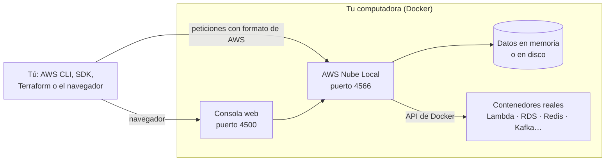

<p align="center">
  
  
</p>

<p align="center">
  <strong>Tu propia nube de AWS, funcionando en tu computadora.</strong><br />
  Sin cuenta de AWS, sin tarjeta de crédito y sin costos.
</p>

---

## ¿De qué se trata?

**AWS Nube Local** es un emulador de Amazon Web Services (AWS) que corre en tu máquina con Docker. Te permite practicar y desarrollar con servicios de AWS como si estuvieras en la nube real, pero todo ocurre en local:

- Creas buckets de **S3**, tablas de **DynamoDB**, colas de **SQS**, funciones **Lambda**, bases de datos **RDS** y muchos servicios más.
- Usas las mismas herramientas de siempre: la **AWS CLI**, los **SDK** (Python, Java, Node.js, Go…), **Terraform** o **CDK**.
- No gastas dinero ni corres el riesgo de dejar algo encendido en una cuenta real.

Es ideal para aprender AWS en clase, hacer prácticas, probar código antes de subirlo a la nube y ejecutar tests automáticos.

> 📘 **¿Primera vez?** Sigue los [manuales paso a paso](manuales/README.md): instalación, consola web, AWS CLI, S3, DynamoDB, SQS/SNS, Lambda y Python.

## Tecnologías

| Tecnología | Para qué se usa |
|---|---|
| **Java 25** | Lenguaje en el que está escrito el emulador |
| **Quarkus 3** | Framework del servidor: arranque rápido y bajo consumo de memoria |
| **Vert.x / JAX-RS** | Servidor HTTP que recibe las peticiones con el mismo formato que AWS |
| **Maven** | Compila el proyecto y gestiona sus dependencias |
| **Docker** | Empaqueta el emulador y levanta contenedores reales para algunos servicios |
| **Docker Compose** | Arranca todo el proyecto con un solo comando |
| **Consola web** | Interfaz en el navegador para ver tus recursos (imagen basada en `floci-ui`) |

## ¿Cómo funciona?



1. **Un solo punto de entrada.** Todo se atiende en `http://localhost:4566`. Cuando la AWS CLI o un SDK hace una petición, el emulador la entiende igual que lo haría AWS y responde con el mismo formato.
2. **Servicios simulados en memoria.** La mayoría de servicios (S3, SQS, SNS, DynamoDB, IAM, KMS, Secrets Manager…) se emulan dentro del propio programa. Son muy rápidos y no necesitan nada más.
3. **Contenedores reales cuando hace falta.** Para servicios que necesitan un motor de verdad, el emulador usa Docker y levanta contenedores reales: Lambda ejecuta tu código en su runtime oficial, RDS arranca un PostgreSQL o MySQL de verdad, ElastiCache usa Redis/Valkey, MSK usa un broker compatible con Kafka, etc.
4. **Credenciales de prueba.** No necesitas una cuenta de AWS: cualquier credencial sirve, por ejemplo `test` / `test`.
5. **Datos temporales o persistentes.** Por defecto los datos viven en memoria y se borran al apagar. Si quieres conservarlos, puedes cambiar el modo de almacenamiento (ver más abajo).

## Desplegarlo en Docker

### Requisitos

- **Docker Desktop** instalado y abierto (Windows, macOS o Linux).
- **Git** para descargar el proyecto.
- Opcional: la **AWS CLI** para probarlo desde tu terminal.

### 1. Descargar el proyecto

```bash
git clone https://github.com/shepro28031628/AWS-LOCAL.git
```

```bash
cd AWS-LOCAL
```

### 2. Construir y arrancar

```bash
docker compose up -d --build
```

Este comando:

- Compila el emulador desde el código fuente dentro de Docker (la primera vez tarda varios minutos porque descarga Maven y las dependencias; las siguientes es mucho más rápido).
- Construye la imagen de la consola web con el logo de AWS Nube Local.
- Arranca el emulador en segundo plano.

En **Docker Desktop → Containers** verás el grupo del proyecto con dos contenedores:

| Contenedor | Estado normal | Qué hace |
|---|---|---|
| `floci` | Running | El emulador de AWS |
| `consola-build` | Exited (0) | Solo construye la imagen de la consola y termina |

### 3. Comprobar que funciona

Abre en el navegador:

- **Panel principal:** <http://localhost:4566/>
- **Consola web:** <http://localhost:4566/_floci/ui> (la primera vez tarda unos segundos en arrancar)

O desde la terminal:

```bash
curl http://localhost:4566/_floci/health
```

### 4. Usarlo con la AWS CLI

Configura las variables de entorno para que la CLI apunte a tu nube local.

**Windows (PowerShell):**

```bash
$env:AWS_ENDPOINT_URL="http://localhost:4566"; $env:AWS_ACCESS_KEY_ID="test"; $env:AWS_SECRET_ACCESS_KEY="test"; $env:AWS_DEFAULT_REGION="us-east-1"
```

**macOS / Linux:**

```bash
export AWS_ENDPOINT_URL=http://localhost:4566 AWS_ACCESS_KEY_ID=test AWS_SECRET_ACCESS_KEY=test AWS_DEFAULT_REGION=us-east-1
```

Y prueba algunos comandos:

```bash
aws s3 mb s3://mi-bucket
```

```bash
aws s3 ls
```

```bash
aws sqs create-queue --queue-name mi-cola
```

```bash
aws dynamodb create-table --table-name alumnos --attribute-definitions AttributeName=id,AttributeType=S --key-schema AttributeName=id,KeyType=HASH --billing-mode PAY_PER_REQUEST
```

¿No tienes la AWS CLI instalada? Puedes usar la que viene dentro del contenedor:

```bash
docker compose exec floci aws s3 ls
```

### 5. Usarlo desde código (ejemplo en Python)

```python
import boto3

s3 = boto3.client(
    "s3",
    endpoint_url="http://localhost:4566",
    region_name="us-east-1",
    aws_access_key_id="test",
    aws_secret_access_key="test",
)

s3.create_bucket(Bucket="mi-bucket")
print(s3.list_buckets()["Buckets"])
```

La idea es la misma en cualquier lenguaje: indicar `http://localhost:4566` como endpoint y credenciales de prueba.

### 6. Apagar, reiniciar y ver logs

| Acción | Comando |
|---|---|
| Apagar | `docker compose down` |
| Volver a encender | `docker compose up -d` |
| Recompilar tras cambiar el código | `docker compose up -d --build` |
| Ver los logs | `docker compose logs -f floci` |

## Configuración útil

Se cambia con variables de entorno en la sección `environment:` del archivo [docker-compose.yml](docker-compose.yml).

| Variable | Valor por defecto | Descripción |
|---|---|---|
| `FLOCI_STORAGE_MODE` | `memory` | Dónde se guardan los datos: `memory` (se borran al apagar), `hybrid` (memoria + guardado en disco cada 5 s), `persistent` (guarda en disco en cada cambio) o `wal` (máxima durabilidad) |
| `FLOCI_DEFAULT_REGION` | `us-east-1` | Región de AWS por defecto |
| `FLOCI_DEFAULT_ACCOUNT_ID` | `000000000000` | ID de cuenta por defecto |
| `FLOCI_SERVICES_UI_IMAGE` | `nube-local/floci-ui:0.7.0` | Imagen de la consola web |

Por ejemplo, para que tus datos no se borren al apagar, añade en `environment:`:

```yaml
FLOCI_STORAGE_MODE: hybrid
```

Los datos se guardan en la carpeta `./data` del proyecto.

## Puertos

| Puerto | Uso |
|---|---|
| `4566` | API de AWS y panel principal |
| `4500` | Consola web |
| `6379-6399` | ElastiCache / MemoryDB (Redis) |
| `7001-7099` | Proxies de bases de datos (RDS, etc.) |
| `9200-9299` | OpenSearch |

## Problemas comunes

- **`failed to connect to the docker API`**: Docker Desktop no está abierto. Ábrelo y espera a que diga *Engine running*.
- **El puerto 4566 ya está en uso**: otro programa (por ejemplo, LocalStack) usa ese puerto. Apágalo o cambia el puerto en `docker-compose.yml`.
- **La consola web no carga**: espera unos segundos tras abrir `/_floci/ui`; la primera vez tiene que arrancar su contenedor.

---

<sub>AWS Nube Local está basado en [Floci](https://github.com/floci-io/floci), un emulador de AWS de código abierto con licencia MIT (ver [LICENSE](LICENSE)). AWS y Amazon Web Services son marcas de Amazon.com, Inc.; este proyecto no está afiliado a Amazon.</sub>
