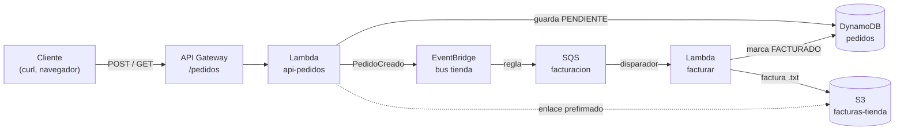

# Proyecto integrador: sistema de pedidos sin servidores

[Volver al índice](README.md)

En este proyecto juntas lo aprendido en una aplicación real: una **API de pedidos** que guarda cada pedido, genera su factura automáticamente y permite descargarla.

## Qué vas a construir



1. `POST /pedidos` crea el pedido en **DynamoDB** con estado `PENDIENTE` y publica un evento `PedidoCreado` en **EventBridge**.
2. Una **regla** envía el evento a la cola **SQS** `facturacion`.
3. La Lambda `facturar` lee la cola, escribe la factura en **S3** y marca el pedido como `FACTURADO`.
4. `GET /pedidos/{id}` devuelve el pedido y, si ya está facturado, un **enlace temporal** para descargar la factura.

¿Por qué así y no todo en una función? Porque la API responde al instante y la facturación ocurre aparte: si la facturación falla o va lenta, los pedidos no se pierden (esperan en la cola) y el cliente no espera.

| Servicio | Manual |
|---|---|
| S3 | [10](10-s3.md) |
| DynamoDB | [11](11-dynamodb.md) |
| SQS | [30](30-sqs.md) |
| EventBridge | [32](32-eventbridge.md) |
| Lambda | [40](40-lambda.md) |
| API Gateway | [41](41-api-gateway.md) |
| CloudWatch | [60](60-cloudwatch.md) |

## Antes de empezar

- Terminal configurada ([manual 3](03-configurar-aws-cli.md)).
- Una carpeta vacía `proyecto-pedidos` para los archivos.
- En Windows usa `curl.exe` (no `curl`) en los comandos de prueba.

---

## Paso 1: almacenamiento

```bash
aws s3 mb s3://facturas-tienda
```

```bash
aws dynamodb create-table --table-name pedidos --attribute-definitions AttributeName=id,AttributeType=S --key-schema AttributeName=id,KeyType=HASH --billing-mode PAY_PER_REQUEST
```

## Paso 2: eventos y cola

```bash
aws events create-event-bus --name tienda
```

```bash
aws sqs create-queue --queue-name facturacion
```

`patron.json` (todos los pedidos creados):

```json
{ "source": ["tienda.pedidos"], "detail-type": ["PedidoCreado"] }
```

`destino.json`:

```json
[ { "Id": "facturacion", "Arn": "arn:aws:sqs:us-east-1:000000000000:facturacion" } ]
```

```bash
aws events put-rule --name facturar-pedidos --event-bus-name tienda --event-pattern file://patron.json
```

```bash
aws events put-targets --rule facturar-pedidos --event-bus-name tienda --targets file://destino.json
```

## Paso 3: la Lambda de la API

`api_pedidos.py`:

```python
import base64
import json
import os
import uuid
from datetime import datetime, timezone
from decimal import Decimal

import boto3

tabla = boto3.resource("dynamodb").Table("pedidos")
eventos = boto3.client("events")
# Para firmar enlaces que se abran desde el navegador. En AWS real no hace falta esta variable.
s3_enlaces = boto3.client("s3", endpoint_url=os.environ.get("S3_URL_PUBLICA"))
BUCKET = os.environ["BUCKET_FACTURAS"]


def a_numero(valor):
    if isinstance(valor, Decimal):
        return int(valor) if valor == valor.to_integral_value() else float(valor)
    raise TypeError(f"No se puede convertir {type(valor)}")


def respuesta(codigo, cuerpo):
    return {"statusCode": codigo, "headers": {"Content-Type": "application/json"},
            "body": json.dumps(cuerpo, default=a_numero, ensure_ascii=False)}


def leer_cuerpo(event):
    cuerpo = event.get("body") or "{}"
    if event.get("isBase64Encoded"):
        cuerpo = base64.b64decode(cuerpo).decode("utf-8")
    return json.loads(cuerpo)


def crear_pedido(event):
    datos = leer_cuerpo(event)
    if not datos.get("cliente") or not datos.get("productos"):
        return respuesta(400, {"error": "Faltan cliente o productos"})
    total = sum(p["precio"] * p["cantidad"] for p in datos["productos"])
    pedido = {
        "id": "P-" + uuid.uuid4().hex[:6].upper(),
        "cliente": datos["cliente"],
        "productos": datos["productos"],
        "total": round(total, 2),
        "estado": "PENDIENTE",
        "fecha": datetime.now(timezone.utc).isoformat(),
    }
    tabla.put_item(Item=json.loads(json.dumps(pedido), parse_float=Decimal))
    eventos.put_events(Entries=[{
        "EventBusName": "tienda",
        "Source": "tienda.pedidos",
        "DetailType": "PedidoCreado",
        "Detail": json.dumps(pedido),
    }])
    print(f"Pedido {pedido['id']} creado por {pedido['total']}")
    return respuesta(201, pedido)


def ver_pedido(event):
    pedido = tabla.get_item(Key={"id": event["pathParameters"]["id"]}).get("Item")
    if not pedido:
        return respuesta(404, {"error": "No existe"})
    if pedido["estado"] == "FACTURADO":
        pedido["factura_url"] = s3_enlaces.generate_presigned_url(
            "get_object", Params={"Bucket": BUCKET, "Key": pedido["factura"]}, ExpiresIn=600)
    return respuesta(200, pedido)


def handler(event, context):
    ruta = event["routeKey"]
    if ruta == "POST /pedidos":
        return crear_pedido(event)
    if ruta == "GET /pedidos/{id}":
        return ver_pedido(event)
    if ruta == "GET /pedidos":
        return respuesta(200, tabla.scan()["Items"])
    return respuesta(400, {"error": f"Ruta no soportada: {ruta}"})
```

Detalles importantes:

| Línea | Por qué |
|---|---|
| `parse_float=Decimal` | DynamoDB no acepta `float` de Python; hay que guardar los decimales como `Decimal` |
| `a_numero` | Al leer, DynamoDB devuelve `Decimal`; lo convertimos para que el JSON muestre números |
| `S3_URL_PUBLICA` | Dentro de Lambda, S3 se llama por una dirección interna. Para que el enlace se abra desde tu navegador, se firma con `http://localhost:4566` |
| `put_events` | La API **no factura**: solo avisa. Otro componente se encarga |

Comprime `api_pedidos.zip` ([cómo](40-lambda.md#antes-de-empezar)) y crea la función:

```bash
aws lambda create-function --function-name api-pedidos --runtime python3.12 --handler api_pedidos.handler --zip-file fileb://api_pedidos.zip --role arn:aws:iam::000000000000:role/lambda-role --environment "Variables={BUCKET_FACTURAS=facturas-tienda,S3_URL_PUBLICA=http://localhost:4566}"
```

## Paso 4: la Lambda de facturación

`facturar.py`:

```python
import json
import os

import boto3

tabla = boto3.resource("dynamodb").Table("pedidos")
s3 = boto3.client("s3")
BUCKET = os.environ["BUCKET_FACTURAS"]


def handler(event, context):
    for registro in event["Records"]:
        evento = json.loads(registro["body"])
        pedido = evento["detail"]

        lineas = [f"FACTURA {pedido['id']}", f"Cliente: {pedido['cliente']}", ""]
        for p in pedido["productos"]:
            lineas.append(f"{p['cantidad']} x {p['nombre']} a {p['precio']} = {p['cantidad'] * p['precio']}")
        lineas += ["", f"TOTAL: {pedido['total']}"]

        clave = f"facturas/{pedido['id']}.txt"
        s3.put_object(Bucket=BUCKET, Key=clave, Body="\n".join(lineas).encode("utf-8"),
                      ContentType="text/plain; charset=utf-8")

        tabla.update_item(
            Key={"id": pedido["id"]},
            UpdateExpression="SET estado = :e, factura = :f",
            ExpressionAttributeValues={":e": "FACTURADO", ":f": clave},
        )
        print(f"Factura generada para {pedido['id']} en s3://{BUCKET}/{clave}")
```

Cada mensaje de la cola trae el evento de EventBridge completo; los datos del pedido están en `detail`.

Comprime `facturar.zip`, crea la función y conéctala a la cola:

```bash
aws lambda create-function --function-name facturar --runtime python3.12 --handler facturar.handler --zip-file fileb://facturar.zip --role arn:aws:iam::000000000000:role/lambda-role --environment "Variables={BUCKET_FACTURAS=facturas-tienda}"
```

```bash
aws lambda create-event-source-mapping --function-name facturar --event-source-arn arn:aws:sqs:us-east-1:000000000000:facturacion --batch-size 5
```

## Paso 5: la API

**Windows (PowerShell):**

```bash
$API = aws apigatewayv2 create-api --name tienda-api --protocol-type HTTP --query ApiId --output text
```

```bash
$INT = aws apigatewayv2 create-integration --api-id $API --integration-type AWS_PROXY --integration-uri arn:aws:lambda:us-east-1:000000000000:function:api-pedidos --payload-format-version 2.0 --query IntegrationId --output text
```

**macOS / Linux:**

```bash
API=$(aws apigatewayv2 create-api --name tienda-api --protocol-type HTTP --query ApiId --output text)
```

```bash
INT=$(aws apigatewayv2 create-integration --api-id $API --integration-type AWS_PROXY --integration-uri arn:aws:lambda:us-east-1:000000000000:function:api-pedidos --payload-format-version 2.0 --query IntegrationId --output text)
```

Rutas y publicación:

```bash
aws apigatewayv2 create-route --api-id $API --route-key "POST /pedidos" --target integrations/$INT
```

```bash
aws apigatewayv2 create-route --api-id $API --route-key "GET /pedidos" --target integrations/$INT
```

```bash
aws apigatewayv2 create-route --api-id $API --route-key "GET /pedidos/{id}" --target integrations/$INT
```

```bash
aws apigatewayv2 create-stage --api-id $API --stage-name prod --auto-deploy
```

```bash
echo $API
```

Tu API queda en `http://localhost:4566/execute-api/ID/prod/pedidos` (cambia `ID`).

## Paso 6: probarlo todo

`pedido.json`:

```json
{
  "cliente": "ana@clase.com",
  "productos": [
    { "nombre": "Teclado", "precio": 25.5, "cantidad": 2 },
    { "nombre": "Ratón", "precio": 12, "cantidad": 1 }
  ]
}
```

**Crear el pedido:**

```bash
curl.exe -X POST http://localhost:4566/execute-api/ID/prod/pedidos -H "Content-Type: application/json" -d "@pedido.json"
```

Respuesta (código `201`) con `"estado": "PENDIENTE"`, `"total": 63.0` y un `id` como `P-2CB269`. La primera vez tarda unos segundos (arranca el contenedor de Lambda).

**Espera unos 10 o 15 segundos** y consulta el pedido:

```bash
curl.exe http://localhost:4566/execute-api/ID/prod/pedidos/P-2CB269
```

Ahora dice `"estado": "FACTURADO"` y trae `factura_url`. **Copia esa URL y ábrela en el navegador**:

```text
FACTURA P-2CB269
Cliente: ana@clase.com

2 x Teclado a 25.5 = 51.0
1 x Ratón a 12 = 12

TOTAL: 63.0
```

**Listar todos los pedidos** (en el navegador):

```text
http://localhost:4566/execute-api/ID/prod/pedidos
```

**Probar la validación:** envía un pedido vacío (crea `vacio.json` con `{}`) y comprueba que responde `400`.

## Paso 7: seguir el rastro con CloudWatch

Cada Lambda dejó sus logs:

```bash
aws logs filter-log-events --log-group-name /aws/lambda/api-pedidos --filter-pattern Pedido --query "events[].message"
```

```bash
aws logs filter-log-events --log-group-name /aws/lambda/facturar --filter-pattern Factura --query "events[].message"
```

Y las facturas en S3:

```bash
aws s3 ls s3://facturas-tienda/facturas/
```

Abre también la [consola web](02-consola-web.md) y busca la tabla `pedidos`, el bucket y las funciones.

---

## Amplía el proyecto

Elige uno o varios:

1. **Avisos por correo:** añade a la regla de EventBridge un segundo destino, un tema SNS `avisos-pedidos`, y suscríbele una cola `correos`.
2. **Errores controlados:** crea una DLQ para `facturacion` ([manual 30](30-sqs.md)) y haz que `facturar` falle si el total supera 10 000. Comprueba que esos pedidos acaban en la DLQ y siguen `PENDIENTE`.
3. **Usuarios:** protege la API con Cognito ([manual 53](53-cognito.md)): cada cliente inicia sesión y solo ve sus pedidos.
4. **Métricas:** publica una métrica `PedidosCreados` en cada `POST` y crea una alarma si en un minuto hay más de 20 ([manual 60](60-cloudwatch.md)).
5. **Infraestructura como código:** pasa los pasos 1 y 2 a una plantilla de CloudFormation ([manual 61](61-cloudformation.md)).
6. **Frontal web:** crea un `index.html` en S3 como web estática ([manual 10](10-s3.md)) con un formulario que llame a la API.

## Limpiar

```bash
aws apigatewayv2 delete-api --api-id $API
```

```bash
aws lambda delete-function --function-name api-pedidos
```

```bash
aws lambda delete-function --function-name facturar
```

```bash
aws s3 rb s3://facturas-tienda --force
```

```bash
aws dynamodb delete-table --table-name pedidos
```

O, más rápido: `docker compose down` y `docker compose up -d` (todo está en memoria).
